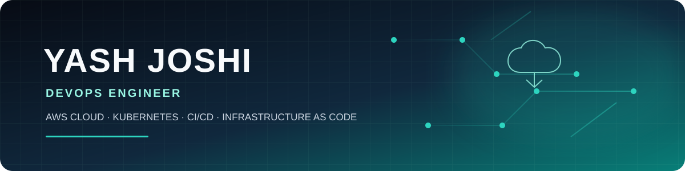
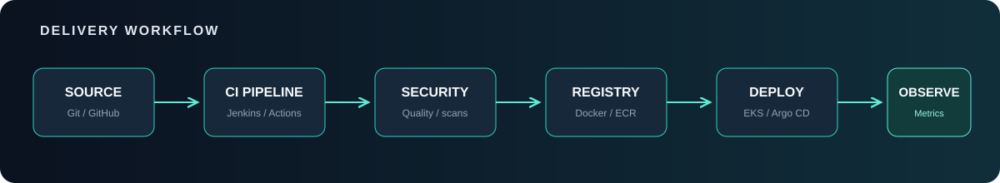

  

# Yash Joshi

**DevOps Engineer · AWS Cloud · Kubernetes · Platform & Infrastructure Automation**

  <a href="https://yash-joshi.vercel.app/">Portfolio</a> ·
  <a href="https://www.linkedin.com/in/yash-joshi-073290251/">LinkedIn</a> ·
  <a href="https://github.com/yashjoshi08">GitHub</a>

---

### Building reliable infrastructure. Automating delivery. Improving operations.

I'm a DevOps Engineer with **3+ years of experience** working across AWS infrastructure, Kubernetes platforms, CI/CD automation, Infrastructure as Code, and production observability.

I focus on the engineering behind reliable releases: repeatable infrastructure, secure delivery pipelines, healthy workloads, and useful monitoring.

  

---

## ⚙️ Engineering toolkit

| Cloud & infrastructure | Delivery & automation |
|---|---|
| AWS · EC2 · VPC · IAM · S3 · RDS · EKS · ECR · ALB · CloudWatch | Jenkins · GitHub Actions · Terraform · Ansible |
| **Containers & orchestration** | **Security & observability** |
| Docker · Kubernetes · Helm · Argo CD · GitOps | SonarQube · Trivy · OWASP Dependency-Check · Prometheus · Grafana |
| **Systems & scripting** | **Engineering practices** |
| Linux · Python · Bash · Git · MySQL | Infrastructure as Code · Release Engineering · Incident Response · Root Cause Analysis |

## 🚀 Featured engineering work

### 01 · Secure AWS delivery
**[AWS ECS Blue-Green CI/CD →](https://github.com/yashjoshi08/aws-ecs-bluegreen-cicd)**

A container delivery workflow built around security checks and controlled releases.

- GitHub Actions pipeline for tests, Bandit, pip-audit and Trivy image scanning.
- GitHub OIDC authentication to AWS, avoiding long-lived access keys.
- Terraform-managed VPC, ALB, ECS, ECR, IAM and CodeDeploy resources.
- ECS Fargate blue-green deployment configuration.

AWS · ECS Fargate · CodeDeploy · Terraform · GitHub Actions · Trivy

---

### 02 · Kubernetes implementation lab
**[KubeStarter →](https://github.com/yashjoshi08/kubestarter)**

Hands-on Kubernetes manifests and implementation references, organized by platform capability.

- Workloads, services, networking and persistent storage.
- RBAC, Ingress, autoscaling, taints and tolerations.
- Helm and deployment strategies.
- Cluster setup guides and EKS notes.

Kubernetes · Helm · EKS · YAML

---

### 03 · Reusable Jenkins pipeline components
**[Jenkins Shared Library →](https://github.com/yashjoshi08/Jenkins_SharedLib)**

Reusable pipeline steps for common build, delivery and security tasks.

- Docker build, push and cleanup helpers.
- SonarQube analysis and quality checks.
- OWASP Dependency-Check and Trivy scanning.
- Groovy shared-library structure using vars directory.

Jenkins · Groovy · Docker · DevSecOps

---

### 04 · Container-to-cluster delivery
**[DevOps Demo Application →](https://github.com/yashjoshi08/devops-demo-app)**

A Node.js application repository demonstrating a Jenkins-driven container deployment workflow.

- Application tests and Docker image build.
- Versioned image publishing to Amazon ECR.
- Kubernetes deployment manifest for EKS.
- Deployment rollout verification using kubectl.

Node.js · Docker · Jenkins · Amazon ECR · EKS

---

## 🧭 How I approach DevOps

| Principle | What it means in practice |
|---|---|
| Infrastructure as Code | Version infrastructure, review changes, and make environments reproducible. |
| Secure by default | Use least privilege, secret management, and automated security checks. |
| Reliable delivery | Automate validation, use safe rollout strategies, and keep rollback paths clear. |
| Observable systems | Combine metrics, logs, dashboards, and actionable alerts. |
| Continuous improvement | Use incidents and operational feedback to improve the platform. |

## 🤝 Connect

If you're working on AWS, Kubernetes, CI/CD, or platform engineering, let's connect.

- **Email:** [joshiyj08@gmail.com](mailto:joshiyj08@gmail.com)
- **Phone:** [+91 9607203556](tel:+919607203556)
- **Portfolio:** [yash-joshi.vercel.app](https://yash-joshi.vercel.app/)
- **LinkedIn:** [Yash Joshi](https://www.linkedin.com/in/yash-joshi-073290251/)
- **GitHub:** [@yashjoshi08](https://github.com/yashjoshi08)

---

Automate the repeatable · Observe the important · Improve continuously

